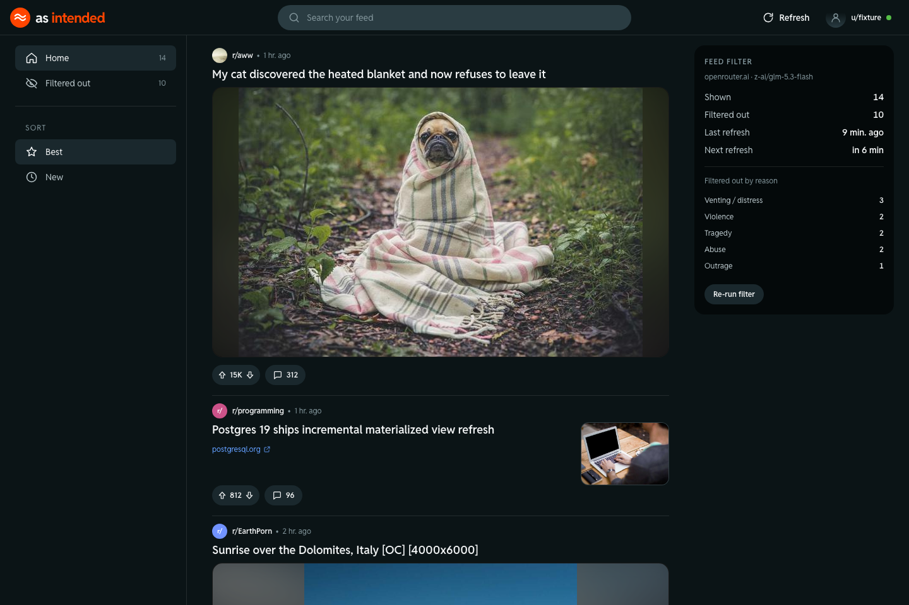

# Reddit As Intended

Reddit home feed without the doomscroll. Reddit As Intended reads your home timeline, has an LLM check every post, and shows only the calm ones on a local page styled like Reddit's dark theme. Click any post to open it on reddit.com.



**Hidden:** violence, tragedy and death, people venting or in a tough spot, self-harm, abuse, rage-bait, disturbing content.
**Kept:** everything else, including upbeat milestones ("1 year sober today") and practical questions.
Every hidden post is listed under **Filtered out** with the reason.

## You need

- [Bun](https://bun.sh) 1.3+, or [Docker](https://docs.docker.com/get-docker/) ([OrbStack](https://orbstack.dev) works too) if you'd rather not install Bun
- A Reddit account
- An API key for an LLM. The default is [OpenRouter](https://openrouter.ai/keys) with `z-ai/glm-5.3-flash`. Filtering 100 posts costs about a quarter of a cent.

## Set up

1. **Download it**

   ```sh
   git clone https://github.com/tejush1998/reddit-as-intended.git
   cd reddit-as-intended
   cp .env.example .env
   ```

2. **Copy your Reddit cookie.** Log in at reddit.com, open DevTools (F12) → **Application** (**Storage** in Firefox) → **Cookies** → `https://www.reddit.com`, and copy the value of `reddit_session`. (Stays valid for 6 months)

3. **Fill in `.env`**

   ```sh
   REDDIT_COOKIE=paste-the-reddit_session-value
   LLM_API_KEY=paste-your-openrouter-key
   ```

4. **Start it** with either one. They share the same port and `data/` folder, so run only one at a time.

   ```sh
   # With Bun
   bun src/main.ts
   ```

   ```sh
   # With Docker
   docker compose up -d --build
   ```

5. Open **http://localhost:8787** and click **Refresh**. The first run takes about a minute, and posts appear as each batch is checked. Automatic refreshing is off by default; set `feed.autoRefresh` to `true` in `config.json` to refresh every `feed.refreshMinutes`.

To stop it: press Ctrl+C (Docker: `docker compose down`). After editing `.env`, restart it (Docker: `docker compose up -d --force-recreate`).

## Customise

- **What gets hidden:** edit [`prompts/filter.md`](prompts/filter.md), then click **Re-run filter** on the page.
- **Another model:** set `LLM_BASE_URL` and `LLM_MODEL` in `.env`. Any OpenAI-compatible `/chat/completions` API works (OpenAI, OpenRouter, Groq, …).
- **Automatic refresh, refresh interval, posts per refresh, batch size:** [`config.json`](config.json) (`feed.autoRefresh` is off by default), then restart the server (Docker: `docker compose restart`).
- **Rate limits:** Refresh is unavailable for `feed.minRefreshSeconds` after each fetch. If Reddit answers 429 (or a 403 block page), all Reddit requests stop for 5 minutes, doubling up to an hour on repeats and surviving restarts. **Re-run filter** still works, because it doesn't touch Reddit.
- **Stopping a run:** click **Stop** while a refresh is running. Posts already classified stay classified; the in-flight batch is retried next run.
- **Retries:** while a run is going, the status next to **Refresh** shows any retry and its countdown, and the right sidebar keeps the count and the last retry for that run. Windows narrower than 960px hide both.
- **Header buttons:** **Messages** opens Reddit chat, **Notifications** opens your Reddit notifications, and the avatar opens your profile. The Messages badge counts unread private messages. The Notifications badge counts comment replies and mentions that arrived since you last clicked it, because a session cookie can't see what Reddit's bell shows. Both update when you load the page, at most once per `feed.minRefreshSeconds`, and on every **Refresh** run. Reddit chat has no cookie-accessible count.

## Run in the background

With Bun on macOS, `bin/reddit on` starts the server if it's off and opens the page, `bin/reddit off` stops it, and `bin/reddit status` checks it. If you use the login agent below, it restarts the server after `off`, so turn the agent off instead.

## Start at login

Docker restarts the server for you as long as Docker is running. With Bun on macOS, this launchd agent starts it at login and restarts it if it crashes. Run it from the project folder:

```sh
cat > ~/Library/LaunchAgents/com.reddit-as-intended.plist <<EOF
<?xml version="1.0" encoding="UTF-8"?>
<plist version="1.0">
<dict>
  <key>Label</key><string>com.reddit-as-intended</string>
  <key>ProgramArguments</key><array><string>$(which bun)</string><string>src/main.ts</string></array>
  <key>WorkingDirectory</key><string>$PWD</string>
  <key>RunAtLoad</key><true/>
  <key>KeepAlive</key><true/>
  <key>StandardOutPath</key><string>$PWD/data/server.log</string>
  <key>StandardErrorPath</key><string>$PWD/data/server.log</string>
</dict>
</plist>
EOF
launchctl load ~/Library/LaunchAgents/com.reddit-as-intended.plist
```

To restart it: `launchctl kickstart -k gui/$(id -u)/com.reddit-as-intended`. To turn it off: `launchctl unload ~/Library/LaunchAgents/com.reddit-as-intended.plist`.

## Troubleshooting

- **Red banner saying "logged out" or "instead of JSON":** the cookie expired or was revoked (logging out of Reddit revokes it). Copy a fresh `reddit_session` into `.env` and restart.
- **Red banner starting with "Filter model":** check `LLM_API_KEY`, `LLM_BASE_URL` and `LLM_MODEL`.
- **Logs:** the terminal running the server, or `data/server.log` if it starts at login. With Docker: `docker compose logs -f`.

## Good to know

- The page is only reachable from your own computer (`127.0.0.1`). Your cookie is only sent to reddit.com.
- Post titles and text are sent to the LLM provider you configure.
- A post only appears after the model approves it. If the model fails, the post stays hidden.
- The feed only shows the latest fetch run. Older posts stay in SQLite (until `feed.keepDays`) but are not displayed or re-classified.
- This uses your own login to read your own feed, 2 requests whenever you refresh and 1 when you load the page, plus 1 when your unread count changes (or every 15 minutes if auto-refresh is enabled). It isn't affiliated with Reddit. If Reddit has approved an API app for you, you can use that instead: see the `REDDIT_CLIENT_*` lines in `.env.example`.

## Development

Needs [Bun](https://bun.sh) 1.3+. No dependencies.

```sh
# 24 labelled sample posts instead of your real feed (then click Refresh)
REDDIT_FIXTURE=test/fixture-listing.json LLM_API_KEY=... bun src/main.ts
```

`src/reddit.ts` reads the feed, `src/filter.ts` sends posts to the LLM in batches, `src/agent.ts` runs cycles triggered from the UI, `src/db.ts` is the SQLite store, `src/main.ts` serves the page and API, and `public/` is the UI.

## License

MIT
